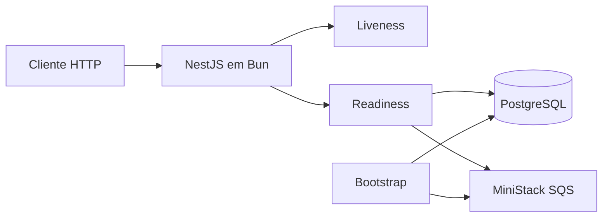
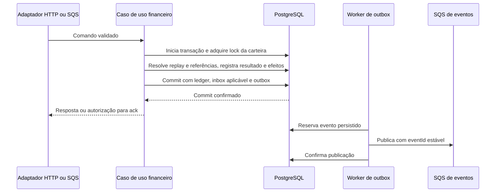

# Arquitetura do Jungle Wagering Processor

## Fundação disponível na Fase 1

O repositório adota um monólito modular com Clean Architecture, Ports & Adapters e DDD tático. A Fase 1 estabelece o processo HTTP, a configuração, as duas dependências e o provisionamento reproduzível. A Fase 2 acrescenta o domínio financeiro puro com Money, Wallet, transações, ledger, inbox, outbox e eventos.

A configuração é validada antes de iniciar o HTTP. O driver inicializa de forma preguiçosa para permitir liveness durante indisponibilidade do banco. Readiness verifica uma consulta PostgreSQL e a acessibilidade das duas filas. O bootstrap e as migrations rodam fora do processo HTTP. No Compose, a API espera os serviços saudáveis e o provisionamento terminar.

## Camadas

| Camada         | Responsabilidade                                                      | Estado atual                                           |
| -------------- | --------------------------------------------------------------------- | ------------------------------------------------------ |
| Domain         | Entidades encapsuladas, agregados, objetos de valor, regras e eventos | Núcleo implementado e testado na Fase 2                |
| Application    | Casos de uso, portas e escopo transacional                            | Motor financeiro, leituras e porta de identidade       |
| Infrastructure | Configuração, persistência, mensageria, workers e observabilidade     | MikroORM, SQS, migrations, probes e logger estruturado |
| Presentation   | Controllers, DTOs, filtros e API                                      | API financeira, health público e OpenAPI               |

As dependências apontam para o domínio e os casos de uso. Controllers adaptam HTTP e chamam a aplicação. Repositórios e clientes externos implementam as portas necessárias. O composition root no NestJS resolve a injeção. Um worker poderá usar um contexto isolado do MikroORM por unidade de trabalho, assim como uma requisição usa seu próprio contexto.

## Decisões técnicas

| Decisão                               | Motivação e trade-off                                                                                                                                                                                                                               |
| ------------------------------------- | --------------------------------------------------------------------------------------------------------------------------------------------------------------------------------------------------------------------------------------------------- |
| Bun 1.x e TypeScript estrito          | O runtime, gerenciador e test runner são comuns aos ambientes. A compilação usa `tsc` para checagem independente e emissão de decorators.                                                                                                           |
| NestJS                                | Módulos, ciclo de vida e composição por injeção com uma API pequena. Domínio e casos de uso permanecem independentes dos decorators.                                                                                                                |
| MikroORM                              | Unit of Work, contexto por requisição e EntityManager transacional. A separação entre entidade de domínio e persistência exige mapeamento explícito.                                                                                                |
| PostgreSQL                            | Fonte de verdade e coordenação entre processos. Saldo, ledger, inbox e outbox compartilham o commit da operação.                                                                                                                                    |
| Migrations reversíveis                | Histórico versionado e execução explícita. O provisionamento é controlado por um processo, separado das réplicas HTTP.                                                                                                                              |
| MiniStack                             | Emulador sem dependência de licença paga. A compatibilidade necessária de FIFO, visibilidade e DLQ é verificada pela suíte real. [Documentação do MiniStack](https://github.com/ministackorg/ministack/tree/v1.5.38)                                |
| Money com precisão exata              | Quantia em string decimal de duas casas na interface e centavos em `bigint` no domínio. PostgreSQL armazena em um domínio sobre `NUMERIC`, com até 36 dígitos inteiros e 2 fracionários. O mapper reidrata a string decimal exata.                  |
| Lock pessimista por wallet            | `SELECT … FOR UPDATE` serializa a movimentação da mesma carteira entre instâncias. Carteiras distintas avançam em paralelo. Uma carteira muito disputada tem fila de contenção. O chamador recebe falhas tipadas de contenção para decidir o retry. |
| Idempotência persistida               | Chave única, hash SHA-256 de JSON canônico dos campos de negócio e unicidade de provedor/ID externo. O resultado histórico é persistido para replay. O custo é manter os índices e o snapshot da resposta.                                          |
| Inbox e outbox transacionais          | Inbox, resultado, alterações de saldo, ledger e eventos partilham o commit. Ack vem depois do commit. A publicação exige um processo independente e pode repetir em caso de crash após envio.                                                       |
| HTTP e SQS compartilham o caso de uso | O adaptador HTTP converte seu contrato para o comando que o consumidor SQS também usará. O domínio decide a regra uma vez e o PostgreSQL protege contra duplicatas intercanal.                                                                      |
| Eventos at-least-once                 | O publicador terá reservas expiradas recuperáveis, backoff e `eventId` persistido. O consumidor pode deduplicar usando o ID estável.                                                                                                                |
| Identidade externa                    | A fase deixa o contrato `ProviderIdentityPort`. Um futuro guard HTTP validará assinatura, emissor, público e expiração com um IdP OIDC, e vinculará a identidade autenticada ao provedor. Health é público.                                         |

## Persistência disponível na Fase 3

Entidades ORM e mappers separados reidratam as cinco entidades de domínio. `TransactionManager` compartilha um EntityManager transacional, usa `READ COMMITTED` e fornece lock por carteira, timeout e erros de contenção identificáveis. A outbox já oferece seleção de eventos devidos e leases com `SKIP LOCKED`. O [schema financeiro](docs/DATABASE_SCHEMA.md) detalha constraints, índices, roles e reversões de migrations.

## Motor financeiro da Fase 4

A abertura e as operações de aposta usam portas independentes de transporte. A aplicação canonicaliza o comando, resolve replay e conflitos, bloqueia a carteira e delega a decisão ao domínio. O adaptador PostgreSQL grava snapshot, movimento, outbox e inbox aplicável no mesmo commit. As consultas usam IDs internos, identidade do provedor e cursor de ledger. A documentação do motor descreve as sequências e a retomada de referências. [Motor financeiro](docs/FINANCIAL_PROCESSING.md)

## API REST da Fase 5

Os controllers NestJS adaptam os contratos HTTP para os casos de uso. Um pipe global usa os schemas Zod dos DTOs com objetos estritos e coerção explícita do limite de paginação. O filtro central traduz erros tipados. POST de aposta devolve `200` para confirmada, `202` para pendente e `422` para rejeição persistida. Conflitos usam `409`. Falhas temporárias usam `503` para permitir reenvio com a chave original. [Contrato HTTP](docs/API_CONTRACT.md)

O middleware associa o `X-Correlation-Id` ao HTTP e aos eventos, com logs JSON por rota e instância. CORS está desabilitado. A API de desenvolvimento escuta em loopback e serve Swagger. O Compose publica a API em loopback, mantém readiness sobre PostgreSQL e MiniStack e executa migrations no serviço de setup.

A avaliação usa API sem autenticação para priorizar os requisitos financeiros. A opção requer uma rede de desenvolvimento ou avaliação isolada. `ProviderIdentityPort` é o ponto de extensão de um guard OIDC. O guard futuro valida assinatura, emissor, público, validade e vínculo do claim do provedor ao comando ou à rota. A autorização também deverá vincular o provedor às carteiras e transações permitidas. Health permanece público.

O PostgreSQL coordena as três instâncias independentes por lock de carteira e restrições únicas. A reconciliação consulta saldo e ledger no mesmo snapshot SQL. O shutdown fecha o listener, drena requisições aceitas e fecha as dependências dentro do prazo configurado. [Concorrência distribuída](docs/DISTRIBUTED_CONCURRENCY.md)

## Integração HTTP e processamento SQS

Os processos `consumer`, `outbox` e `references` usam o mesmo código financeiro da API. O consumer recebe `WagerTransactionRequested`, registra o recibo dentro da transação financeira e confirma a mensagem após o commit. O publisher envia à fila `wager-events` fora da transação SQL do claim. O worker de referências usa agenda persistida e o lock da carteira. [Arquitetura da mensageria](docs/MESSAGING_ARCHITECTURE.md) · [ADR 0003](docs/adr/0003-distributed-messaging.md)

O schema da Fase 3 protege unicidade de carteira por jogador e moeda, transação externa por provedor, chave idempotente global, inbox por consumidor e ID, ledger por transação e carteira e reversões aplicadas. O lançamento é a via autorizada para atualizar saldo e versão materializados. O PostgreSQL valida saldo anterior, direção, valor e saldo posterior, com proteção de imutabilidade e não negatividade. A auditoria compara saldo armazenado e soma do ledger no mesmo snapshot.

### Contratos financeiros da Fase 2

O [modelo de domínio](docs/DOMAIN_MODEL.md) descreve as factories, os fluxos e os testes. `WagerTransaction.apply` aplica a operação sobre a carteira. A carteira produz o lançamento antes da mudança de saldo e captura a versão nele.

- `PENDING` pode avançar para `PENDING_REFERENCE`, `PROCESSED`, `REJECTED` ou `FAILED`. `PENDING_REFERENCE` mantém a agenda ou avança para um estado terminal. `PROCESSED`, `REJECTED` e `FAILED` encerram o ciclo de vida.
- `OPENING` é interno. Abertura positiva gera crédito e a versão inicial é 1. `LOSS` registra o resultado sem lançamento ou avanço de versão.
- `WIN` aceita referência opcional a uma `BET` processada. `REFUND` e `ROLLBACK` exigem referência íntegra e valor integral. As referências devem corresponder a provedor, jogador, wallet, moeda e rodada.
- A decisão inicial trata `REFUND` e `ROLLBACK` diretos da mesma `BET` como alternativas para evitar dois créditos. `ROLLBACK` da própria `REFUND` continua permitido. Trata-se de uma interpretação adicional à proteção mínima do enunciado por tipo.
- Referência ausente fica pendente com snapshot persistido. O worker agenda novas verificações com backoff e registra `REFERENCE_NOT_FOUND` com evento de rejeição quando o limite acaba.
- Códigos de negócio definidos incluem `INSUFFICIENT_FUNDS`, `REVERSAL_INSUFFICIENT_FUNDS`, `INVALID_REFERENCE`, `AMOUNT_MISMATCH`, `CURRENCY_MISMATCH` e `ALREADY_REVERSED`. Idempotência divergente é conflito. Falha transitória de dependência é indisponibilidade.
