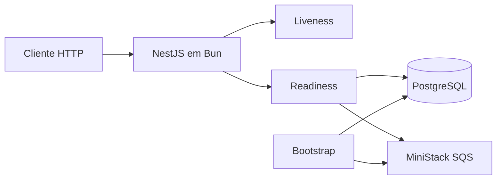
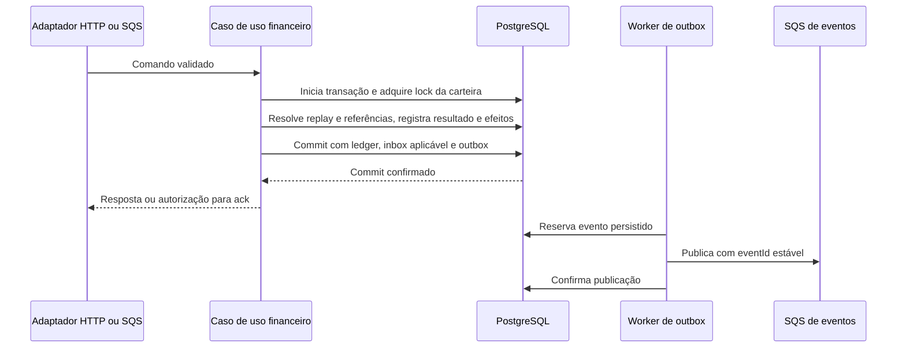

# Arquitetura do Jungle Wagering Processor

## Fundação disponível na Fase 1

O repositório adota um monólito modular com Clean Architecture, Ports & Adapters e DDD tático. A Fase 1 estabelece o processo HTTP, a configuração, as duas dependências e o provisionamento reproduzível. A Fase 2 acrescenta o domínio financeiro puro com Money, Wallet, transações, ledger, inbox, outbox e eventos.

A configuração é validada antes de iniciar o HTTP. O driver inicializa de forma preguiçosa para permitir liveness durante indisponibilidade do banco. Readiness verifica uma consulta PostgreSQL e a acessibilidade das duas filas. O bootstrap e as migrations rodam fora do processo HTTP. No Compose, a API espera os serviços saudáveis e o provisionamento terminar.

## Camadas

| Camada         | Responsabilidade                                                      | Estado atual                                           |
| -------------- | --------------------------------------------------------------------- | ------------------------------------------------------ |
| Domain         | Entidades encapsuladas, agregados, objetos de valor, regras e eventos | Núcleo implementado e testado na Fase 2                |
| Application    | Casos de uso, portas e escopo transacional                            | Contrato de identidade para a futura integração OIDC   |
| Infrastructure | Configuração, persistência, mensageria, workers e observabilidade     | MikroORM, SQS, migrations, probes e logger estruturado |
| Presentation   | Controllers, DTOs, filtros e API                                      | Health público e documentação OpenAPI                  |

As dependências apontam para o domínio e os casos de uso. Controllers adaptam HTTP e chamam a aplicação. Repositórios e clientes externos implementam as portas necessárias. O composition root no NestJS resolve a injeção. Um worker poderá usar um contexto isolado do MikroORM por unidade de trabalho, assim como uma requisição usa seu próprio contexto.

## Decisões técnicas

| Decisão                               | Motivação e trade-off                                                                                                                                                                                                                       |
| ------------------------------------- | ------------------------------------------------------------------------------------------------------------------------------------------------------------------------------------------------------------------------------------------- |
| Bun 1.x e TypeScript estrito          | O runtime, gerenciador e test runner são comuns aos ambientes. A compilação usa `tsc` para checagem independente e emissão de decorators.                                                                                                   |
| NestJS                                | Módulos, ciclo de vida e composição por injeção com uma API pequena. Domínio e casos de uso permanecem independentes dos decorators.                                                                                                        |
| MikroORM                              | Unit of Work, contexto por requisição e EntityManager transacional. A separação entre entidade de domínio e persistência exige mapeamento explícito.                                                                                        |
| PostgreSQL                            | Fonte de verdade e coordenação entre processos. Saldo, ledger, inbox e outbox terão um único commit por operação.                                                                                                                           |
| Migrations reversíveis                | Histórico versionado e execução explícita. O provisionamento é controlado por um processo, separado das réplicas HTTP.                                                                                                                      |
| MiniStack                             | Emulador sem dependência de licença paga. A compatibilidade necessária de FIFO, visibilidade e DLQ é verificada pela suíte real. [Documentação do MiniStack](https://github.com/ministackorg/ministack/tree/v1.5.38)                        |
| Money com precisão exata              | Quantia em string decimal de duas casas na interface e centavos em `bigint` no domínio. PostgreSQL armazenará `NUMERIC` e o mapper reidratará a string sem conversão para ponto flutuante. A precisão máxima será definida junto do schema. |
| Lock pessimista por wallet            | `SELECT … FOR UPDATE` serializa a movimentação da mesma carteira entre instâncias. Carteiras distintas avançam em paralelo. Uma carteira muito disputada tem fila de contenção. Timeouts e retries limitados ficam na aplicação.            |
| Idempotência persistida               | Chave única, hash SHA-256 de JSON canônico dos campos de negócio e unicidade de provedor/ID externo. O resultado histórico é persistido para replay. O custo é manter os índices e o snapshot da resposta.                                  |
| Inbox e outbox transacionais          | Inbox, resultado, alterações de saldo, ledger e eventos futuros partilham o commit. Ack vem depois do commit. A publicação exige um processo independente e pode repetir em caso de crash após envio.                                       |
| HTTP e SQS compartilham o caso de uso | Os adaptadores convertem seus contratos para o mesmo comando. O domínio decide a regra uma vez e o PostgreSQL protege contra duplicatas intercanal.                                                                                         |
| Eventos at-least-once                 | O publicador terá reservas expiradas recuperáveis, backoff e `eventId` persistido. O consumidor pode deduplicar usando o ID estável.                                                                                                        |
| Identidade externa                    | A fase deixa o contrato `ProviderIdentityPort`. Um futuro guard HTTP validará assinatura, emissor, público e expiração com um IdP OIDC, e vinculará a identidade autenticada ao provedor. Health é público.                                 |

## Fluxo financeiro previsto para as próximas etapas

O schema futuro protegerá unicidade de carteira por jogador e moeda, transação externa por provedor, chave idempotente, inbox por consumidor e ID, ledger por transação e carteira e reversões aplicadas. Um lançamento deverá ser a via autorizada para atualizar saldo e versão materializados. O PostgreSQL validará saldo anterior, direção, valor e saldo posterior, com proteção de imutabilidade e não negatividade. A reconciliação comparará saldo armazenado e soma do ledger em um mesmo snapshot.

### Contratos financeiros da Fase 2

O [modelo de domínio](docs/DOMAIN_MODEL.md) descreve as factories, os fluxos e os testes. `WagerTransaction.apply` aplica a operação sobre a carteira. A carteira produz o lançamento antes da mudança de saldo e captura a versão nele.

- `PENDING` pode avançar para `PENDING_REFERENCE`, `PROCESSED`, `REJECTED` ou `FAILED`. `PENDING_REFERENCE` mantém a agenda ou avança para um estado terminal. `PROCESSED`, `REJECTED` e `FAILED` encerram o ciclo de vida.
- `OPENING` é interno. Abertura positiva gera crédito e a versão inicial é 1. `LOSS` registra o resultado sem lançamento ou avanço de versão.
- `WIN` aceita referência opcional a uma `BET` processada. `REFUND` e `ROLLBACK` exigem referência íntegra e valor integral. As referências devem corresponder a provedor, jogador, wallet, moeda e rodada.
- A decisão inicial trata `REFUND` e `ROLLBACK` diretos da mesma `BET` como alternativas para evitar dois créditos. `ROLLBACK` da própria `REFUND` continua permitido. Trata-se de uma interpretação adicional à proteção mínima do enunciado por tipo.
- Referência ausente fica pendente com backoff persistido. No fim do prazo, a rejeição usa `REFERENCE_NOT_FOUND`. O prazo será dimensionado junto dos testes de reprocessamento.
- Códigos de negócio definidos incluem `INSUFFICIENT_FUNDS`, `REVERSAL_INSUFFICIENT_FUNDS`, `INVALID_REFERENCE`, `AMOUNT_MISMATCH`, `CURRENCY_MISMATCH` e `ALREADY_REVERSED`. Idempotência divergente é conflito. Falha transitória de dependência é indisponibilidade.
