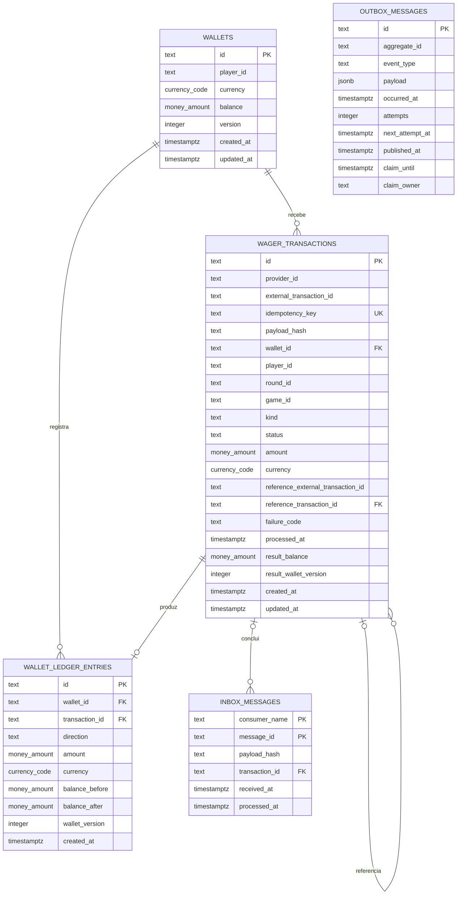

# Persistência financeira

## Modelo relacional



A wallet tem chave única por jogador e moeda. A transação tem unicidade por provedor e ID externo e por chave idempotente global. O ledger tem unicidade por transação e wallet, e por wallet e versão. A inbox usa uma chave primária composta. A reversão aplicada tem uma referência interna única no índice parcial de REFUND e ROLLBACK.

## Dinheiro e identificadores

As colunas monetárias usam o domínio SQL `wagering.money_amount`, baseado em `NUMERIC` sem coerção para uma escala fixa na entrada. O CHECK valida faixa de `0.00` até `999999999999999999999999999999999999.99` e escala de até dois dígitos. Assim, valores como `1.001`, `NaN` e infinitos são rejeitados pelo PostgreSQL. Conversões de leitura projetam o NUMERIC como texto e completam a escala para duas casas antes de reidratar Money. A reconciliação também lê a soma como texto e retorna a diferença exata.

IDs internos e externos usam texto opaco não vazio. O domínio aceita UUIDs e outros identificadores, inclusive os identificadores reservados de abertura. A coluna de moeda valida a lista congelada que o Bun 1.4.4 aceita no domínio. FKs compostas e triggers asseguram a mesma moeda e identidade entre os registros. Datas são `TIMESTAMPTZ` finitos e saem do ORM como `Date`.

## Constraints, triggers e índices

| Tabela                           | Garantias e acesso                                                                                                                                                                                                                    |
| -------------------------------- | ------------------------------------------------------------------------------------------------------------------------------------------------------------------------------------------------------------------------------------- |
| `wallets`                        | Saldo inicial zero, versão 1, identidade imutável e unicidade por jogador e moeda. `guard_wallet_projection` exige a próxima entrada para alterar saldo ou versão.                                                                    |
| `wager_transactions`             | FK composta para wallet, FK para referência, estados, valores e formas de referência validados. Há unicidade global da chave idempotente e por provedor e ID externo.                                                                 |
| `wager_transactions` e reversões | O índice parcial `uq_wager_processed_reversal` limita a uma reversão processada por referência interna. Resolve o conflito entre REFUND e ROLLBACK diretos de uma BET. O ROLLBACK da própria REFUND tem um ID de referência distinto. |
| `wallet_ledger_entries`          | FK composta exige a mesma wallet, valor e moeda da transação. Unicidade por transação e wallet, e por wallet e versão. CHECK de direção e aritmética. O trigger `ledger_append_only` bloqueia UPDATE, DELETE e TRUNCATE.              |
| `inbox_messages`                 | PK composta por consumidor e mensagem, hash preservado e data de processamento igual ou posterior ao recebimento. O repositório marca o processamento com guarda da chave, hash e estado.                                             |
| `outbox_messages`                | PK pelo ID do evento, payload JSONB como objeto, tentativas não negativas, agenda e lease coerentes. `ix_outbox_due` cobre a ordem de disponibilidade por data e ID para eventos pendentes.                                           |

O índice `ix_wager_pending_reference` atende a busca de dependentes pelo provedor e ID externo da referência. A unicidade de wallet e versão permite paginação do ledger pelo cursor interno. A consulta usa limite e ordenação estável.

## Aplicação transacional e concorrência

O TransactionManager fornece os cinco repositórios no mesmo EntityManager sob `READ COMMITTED`. Metadados e mappers do ORM ficam na infraestrutura. Cada execução usa seu próprio contexto. Chamadas internas reutilizam os repositórios recebidos no callback. A escrita de um lançamento atualiza a projeção da wallet em um trigger `AFTER INSERT`. O trigger valida status e direção, snapshot de resultado, versão seguinte e saldo anterior. Uma abertura positiva preserva versão 1. A constraint diferível `require_processed_ledger` exige que todo movimento processado chegue ao commit com o lançamento. LOSS preserva o snapshot e a versão.

O motor adquire `lockById` antes de validar saldo, resolver a referência e persistir os efeitos em conjunto. `FOR UPDATE` limita a contenção à carteira envolvida. O timeout de lock é local à transação. Contenção, deadlock e falha de serialização usam erros identificáveis. A aplicação trata a disputa de unicidade com uma releitura após rollback. A política de retry de falhas transitórias pertence ao chamador.

A migração `Migration20261118000400` acrescenta `reference_attempts`, `reference_next_attempt_at` e o índice parcial `ix_wager_reference_due` para reprocessamento. A mesma migração acrescenta `parked_at` e atualiza `ix_outbox_due`. O publisher reivindica linhas por `FOR UPDATE SKIP LOCKED` e finaliza por token e vencimento do claim. Eventos estacionados permanecem armazenados para recuperação operacional. [Arquitetura de mensageria](MESSAGING_ARCHITECTURE.md)

## Consultas de verificação

```sql
select id, balance::text, version
from wagering.wallets
where player_id = 'player-id' and currency = 'BRL';

select id, status, result_balance::text, result_wallet_version
from wagering.wager_transactions
where idempotency_key = 'provider:external-id';

select id, direction, amount::text, balance_after::text, wallet_version
from wagering.wallet_ledger_entries
where wallet_id = 'wallet-id' and wallet_version > 0
order by wallet_version limit 50;

select id, event_type, coalesce(next_attempt_at, occurred_at) as due_at
from wagering.outbox_messages
where published_at is null
order by coalesce(next_attempt_at, occurred_at), id limit 50;
```

O método `ledger.auditBalance(walletId)` usa uma única instrução SQL para ler saldo, somar créditos e débitos e contar lançamentos no mesmo snapshot. Retorna a divergência sem escrever dados.

## Migrations e ambientes

1. `Migration20261118000000` cria o schema.
2. `Migration20261118000100` cria tipos, tabelas, constraints e índices.
3. `Migration20261118000200` instala os guards, a projeção de saldo e os triggers de imutabilidade.
4. `Migration20261118000300` permite preencher o snapshot de `PENDING_REFERENCE` e adiciona `requested_currency`, que conserva a moeda original em rejeições por divergência sob um CHECK e um guard de imutabilidade.
5. `Migration20261118000400` acrescenta o agendamento de referências e os leases da Outbox.
6. `Migration20261118000500` acrescenta um índice para recuperar a correlação de referências pendentes na Outbox.
7. `Migration20261118000600` acrescenta `transaction_id` opcional à Inbox. `fk_inbox_wager` valida a existência do wager e `ck_inbox_transaction_completed` exige `processed_at` quando houver vínculo. A migração preserva recibos anteriores e bloqueia rollback quando a coluna contém vínculos.

As migrations são transacionais e têm reversões testadas em bancos descartáveis. O rollback recusa desproteger carteiras existentes ou remover tabelas com registros. A metadata ORM é usada para mapeamento. A evolução do schema usa migrations versionadas.

A configuração de desenvolvimento aponta o pgAdmin e a API para o seu `jungle_db` na porta `5432`. A suíte usa a conexão `TEST_DATABASE_URL` do Compose e bancos temporários próprios. A preparação e os comandos de teste estão no [README](../README.md).

## Privilégios

A conta de migrations é proprietária do schema. A conta de execução em ambiente implantado recebe acesso de leitura, inserção e atualização apenas dos campos operacionais. PostgreSQL exige algum privilégio de UPDATE para `FOR UPDATE`, por isso a conta pode receber UPDATE de `updated_at` na wallet. O guard de projeção exige o ledger para a alteração. O trigger de projeção executa com privilégios da conta proprietária e um `search_path` fixo.

Aplique o [arquivo de grants](../scripts/bootstrap/database-privileges.sql) após as migrations. O procedimento provisiona os privilégios de runtime e leitura para auditoria. [Segurança operacional](SECURITY.md)

O Compose de desenvolvimento usa sua conta local de bootstrap. Os testes demonstram a política com um papel temporário restrito. Administradores com privilégios de DDL podem remover triggers e constraints. A proteção operacional depende da separação dos papéis.

## Escopo de integração

O schema protege saldo, encadeamento, referências, imutabilidade e unicidade. HTTP e SQS usam o mesmo TransactionManager para preparar transação, lançamento, Inbox e Outbox no mesmo commit. A camada de aplicação implementa canonicalização, replay histórico e retomada de referência pelo mesmo ID. [Motor financeiro](FINANCIAL_PROCESSING.md) · [Arquitetura de mensageria](MESSAGING_ARCHITECTURE.md)
