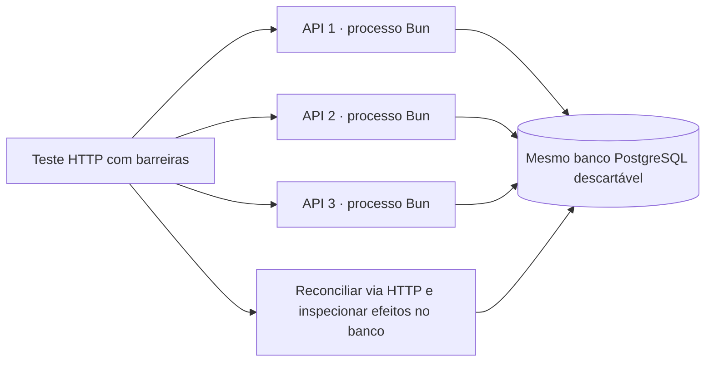

# Concorrência distribuída

A unidade de concorrência é a carteira. O PostgreSQL aplica lock de linha com `SELECT FOR UPDATE`, unicidade de operações e as constraints que ligam o saldo materializado ao ledger. O caso de uso relê a chave idempotente após obter o lock. A resposta HTTP é liberada depois do commit de transação, ledger e outbox. Repetições de uma operação fechada leem o snapshot persistido.



## Reprodução no PowerShell

```powershell
docker compose --env-file .env.example up -d --wait postgres sqs
bun --env-file=.env.example scripts/bootstrap/infra.ts provision
bun run test:distributed
```

O comando compila a aplicação e inicia três subprocessos Bun com PIDs, portas de loopback e pools separados. O harness provisiona um `financial_test_<uuid>` com as migrations, espera readiness e libera os processos antes de remover o banco. A regressão usa `TEST_DATABASE_URL` na porta `5434`.

As provas sincronizadas mantêm um lock legítimo de teste e observam as conexões bloqueadas de cada instância no `pg_stat_activity`. O harness libera o lock quando as APIs chegaram à disputa. O resultado independe da ordem de chegada ou do PID vencedor.

| Cenário                                  | Prova automatizada                                                                                                                                                                               |
| ---------------------------------------- | ------------------------------------------------------------------------------------------------------------------------------------------------------------------------------------------------ |
| Duas BETs de `80.00` sobre `100.00`      | Três rodadas com carteiras novas. Uma resposta `200` e uma `422`, saldo e reconciliação de `20.00`, um débito e outbox sem duplicação ao reenviar.                                               |
| Cinquenta cópias da mesma BET de `25.00` | Três processos disputam a carteira. Uma resposta original e 49 replays HTTP `200` com o mesmo ID e saldo histórico de `75.00`. O banco contém uma BET, um débito e dois eventos da aposta.       |
| Carteiras independentes                  | Duas carteiras avançam enquanto uma terceira aguarda lock. A primeira tentativa bloqueada retorna `503 LOCK_TIMEOUT`. O retry aplica uma vez e a reconciliação é consistente nas três carteiras. |
| REFUND e ROLLBACK concorrentes           | Uma reversão de cada cenário aplica o crédito e a outra registra `ALREADY_REVERSED`. Repetir a vencedora em outro processo devolve o resultado histórico.                                        |
| Processo reiniciado após commit          | As demais APIs continuam recebendo operações. Uma WIN muda o saldo para `125.00`. O processo reiniciado devolve o saldo histórico de `75.00` para a BET original.                                |
| Resposta perdida                         | Um proxy de teste descarta a resposta após a API confirmar o commit. O reenvio para outra instância recupera o mesmo resultado e o banco tem um único débito.                                    |
| Processo encerrado em voo                | O teste observa o processo aguardando o lock da carteira antes de encerrá-lo. O banco preserva somente o estado confirmado e a repetição aplica a aposta uma vez.                                |

A reconciliação HTTP compara a projeção e a soma do ledger em uma consulta SQL. Os testes também contam transações, lançamentos de crédito e débito e eventos da outbox no banco.

## Falhas recuperáveis e encerramento

O timeout de lock da operação é de 1 segundo por transação. Deadlock, falha de serialização, timeout e perda de conexão são classificados como recuperáveis. O cliente usa a mesma chave para reenvio, inclusive quando perde a confirmação. O teste com deadlock PostgreSQL está em `bun run test:concurrency`. `bun run test:e2e` verifica a queda e recuperação da conexão, saturação do pool, reenvio após timeout do cliente e escoamento de uma requisição durante shutdown.

No desligamento por SIGINT ou SIGTERM o servidor para de escutar, fecha conexões ociosas, espera as requisições aceitas e encerra as dependências NestJS. `SHUTDOWN_TIMEOUT_MS` limita a espera a 10 segundos por padrão. No prazo esgotado o processo fecha as conexões restantes e sai com erro. O processo seguinte pode recuperar um resultado de commit pela mesma chave.

Os testes usam PostgreSQL e MiniStack reais do Compose em uma máquina. Consumidor SQS, ack depois do commit, agendamento de referências e publicador de eventos pertencem à Fase 6.
