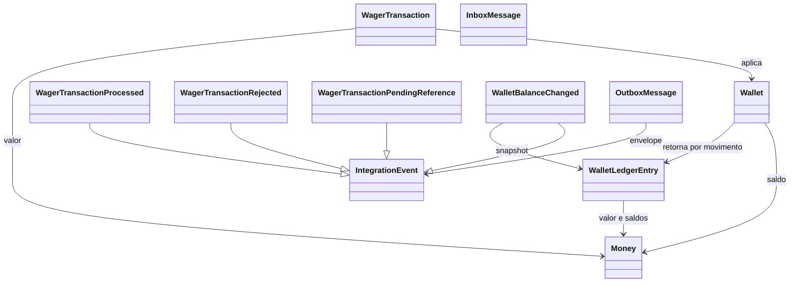
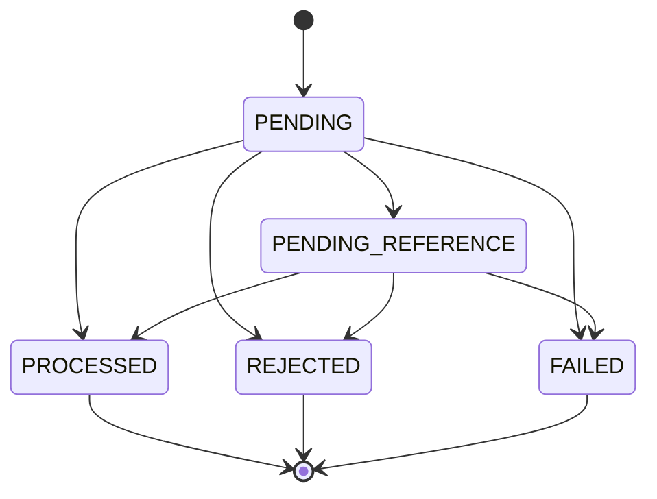
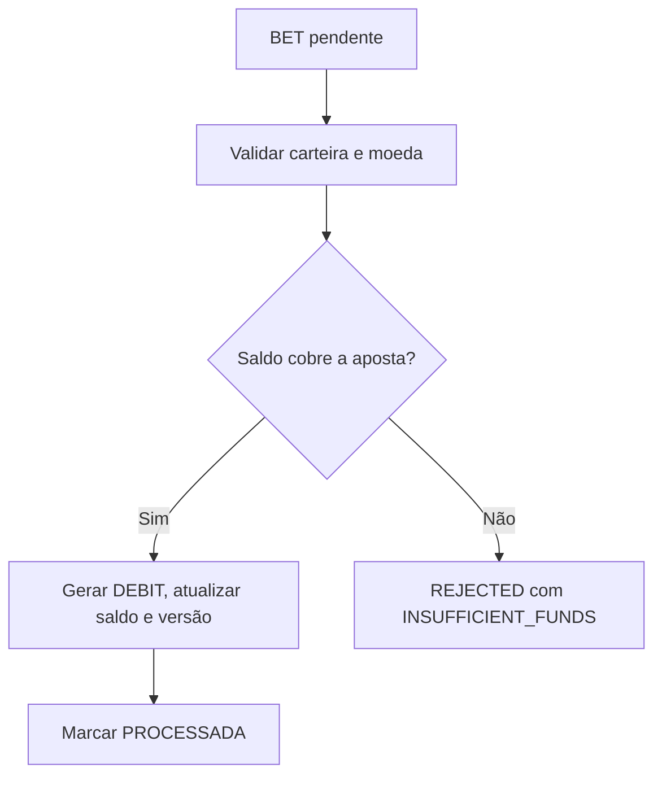
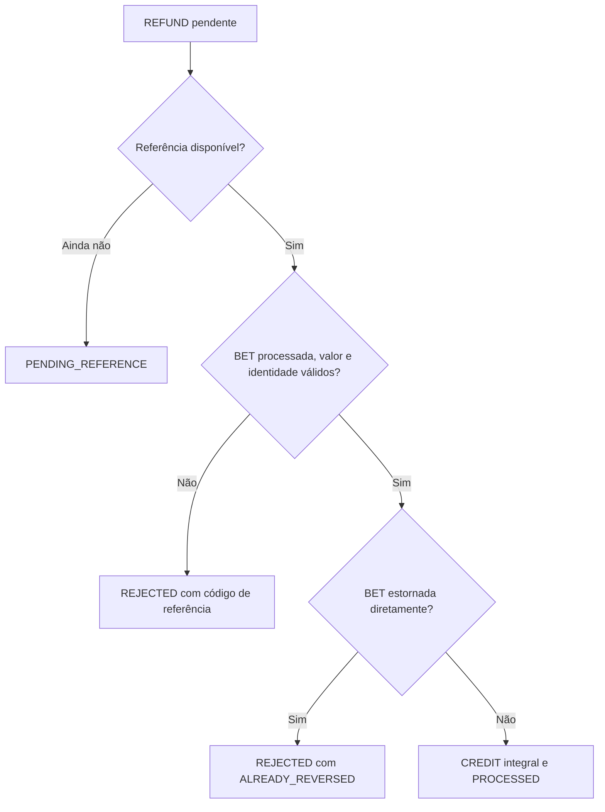
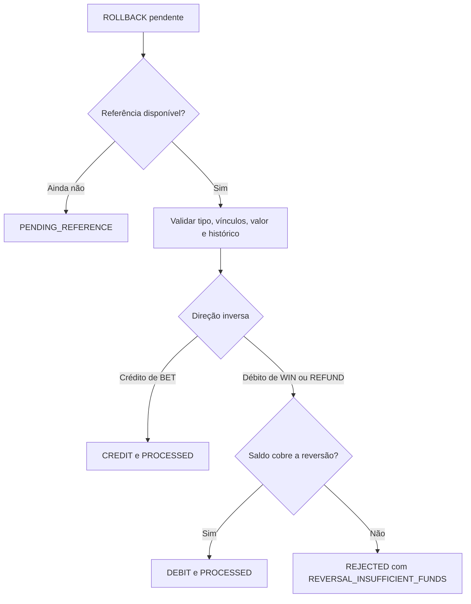

# Modelo de domínio financeiro

O núcleo da Fase 2 modela os efeitos de uma operação sobre uma carteira, o registro no ledger e os dados que poderão integrar a outbox. Os objetos só dependem de TypeScript e APIs padrão. As factories de criação verificam invariantes. `rehydrate` reconstrói o estado persistido e confia nas garantias do mapper e do schema.

## Objetos e responsabilidades

### Money

`Money.from({ amount: "25.00", currency: "BRL" })` recebe uma string decimal não negativa de duas casas exatas. Os códigos devem estar na lista de moedas ISO 4217 suportadas pelo runtime. Todas as moedas seguem a escala de dois dígitos deste desafio, inclusive quando sua escala usual difere. Zeros à esquerda são normalizados na saída. Notação científica, ponto flutuante na entrada, espaços, sinais e escala diferente são inválidos.

O valor é armazenado em um `bigint` de centavos. Soma, subtração e negação têm escala fixa e retornam novos objetos. Subtração e negação permitem negativos intermediários. `toJSON()` converte o valor para string antes da serialização. Igualdade e comparação também verificam a moeda. O limite de precisão de persistência será definido na Fase 3.

### Wallet e abertura

`Wallet` guarda saldo, moeda, versão e datas. Créditos e débitos retornam um `WalletLedgerEntry` pronto. Um movimento positivo é validado e vira lançamento antes da mutação. Movimentos zero deixam saldo, versão e horário de atualização intactos. Um débito insuficiente mantém o agregado no estado anterior. Os horários vêm do chamador e são copiados nas fronteiras.

`openWallet` é o fluxo que combina carteira e registro financeiro inicial. O saldo inicial positivo exige IDs e hash fornecidos pelo chamador. A abertura produz juntos a carteira na versão 1, a transação interna `OPENING` processada e o crédito de zero ao saldo inicial. Para saldo zero a factory retorna somente a carteira. O código da próxima etapa persiste todos os resultados da abertura na mesma transação.

### WagerTransaction

`apply(wallet, context)` executa a regra financeira sobre objetos hidratados. O contexto traz a data, o ID para o eventual lançamento, a referência já resolvida e o histórico de reversões aplicadas para a referência. O resultado distingue `PROCESSED` com eventual entrada, `REJECTED` com código e `PENDING_REFERENCE`. Cada rejeição de negócio preserva a carteira e dispensa lançamento. Uso inválido da API e violação de invariantes lançam erros de domínio.

`matchesPayload` compara o hash fornecido. Canonicalização, cálculo do hash, replay histórico e unicidade persistente serão implementados na orquestração e no banco.

A submissão nasce em `PENDING`. Um comando já em `PENDING_REFERENCE` pode ser avaliado novamente e permanecer pendente enquanto a referência estiver indisponível. Isso preserva o estado existente. Uma chamada explícita e redundante a `markPendingReference()` é inválida. Os estados terminais recusam todas as transições. `FAILED` registra a decisão de uma camada externa sobre uma falha permanente. Falhas transitórias permanecem sob responsabilidade da infraestrutura.

### Ledger

Cada registro guarda transação, carteira, direção, quantia, saldos anterior e posterior, versão da carteira após o movimento e horário. A factory verifica quantia positiva, saldos não negativos, moeda comum e a equação `antes + crédito = depois` ou `antes - débito = depois`. A versão capturada permite criar `WalletBalanceChanged` mesmo quando o agregado já sofreu outro movimento. Objetos e saldos são imutáveis. Datas são cópias defensivas.

## Regras financeiras

| Operação | Efeito                                              | Referência                                                                            |
| -------- | --------------------------------------------------- | ------------------------------------------------------------------------------------- |
| OPENING  | Crédito de abertura na versão 1                     | Factory interna, com valor positivo                                                   |
| BET      | Débito positivo                                     | Nenhuma                                                                               |
| WIN      | Crédito positivo                                    | Opcional. Se presente, exige BET processada e compatível. O prêmio tem valor próprio. |
| LOSS     | Resultado processado com saldo e versão preservados | Nenhuma. Valor informativo não negativo.                                              |
| REFUND   | Crédito integral                                    | BET processada compatível                                                             |
| ROLLBACK | Crédito para BET ou débito para WIN/REFUND          | Transação processada compatível com valor integral                                    |

A referência deve corresponder ao identificador externo solicitado, ao provedor, jogador, carteira, moeda e rodada. Uma referência ausente ou válida ainda pendente mantém a operação em espera. Uma referência rejeitada ou com falha permanente causa rejeição da dependente. Uma BET pode receber apenas um estorno direto. REFUND e ROLLBACK diretos competem pela mesma BET para evitar dois créditos. ROLLBACK da própria REFUND segue permitido. O histórico recebido só bloqueia operações já processadas. A unicidade entre processos será aplicada no PostgreSQL.

### Fluxo de BET

### Fluxo de REFUND

### Fluxo de ROLLBACK

## Inbox, outbox e eventos

- `InboxMessage.receive` valida identificação, consumidor, hash e data. `markProcessed` grava a primeira data válida e recusa nova marcação. O consumidor futuro checa `isProcessed()` para tratar replay.
- `OutboxMessage.enqueue` captura o envelope JSON com ID igual ao `eventId`. O payload é copiado e congelado recursivamente. Tentativas contam falhas agendadas. A primeira falha usa o atraso base e cada falha seguinte dobra o intervalo até o teto. O padrão é base de 1 segundo e teto de 60 segundos. Datas e a política são explícitas para manter determinismo. Publicar encerra o ciclo e limpa o próximo retry.
- `IntegrationEvent` define um envelope versionado com IDs, instante ISO-8601 e payload JSON. `WagerTransactionProcessed` inclui LOSS, `WagerTransactionRejected` carrega o código, `WagerTransactionPendingReference` identifica a dependência e `WalletBalanceChanged` registra o efeito do lançamento. IDs de evento, correlação e causa são dados da operação.

## Erros e limites

| Categoria                        | Códigos                                                                                                                            |
| -------------------------------- | ---------------------------------------------------------------------------------------------------------------------------------- |
| Saldo e compatibilidade          | `INSUFFICIENT_FUNDS`, `REVERSAL_INSUFFICIENT_FUNDS`, `CURRENCY_MISMATCH`, `WALLET_MISMATCH`                                        |
| Referência ou reversão rejeitada | `INVALID_REFERENCE`, `REFERENCE_NOT_FOUND`, `REFERENCE_TYPE_NOT_ALLOWED`, `AMOUNT_MISMATCH`, `ALREADY_REVERSED`                    |
| Uso da API de domínio            | `INVALID_TRANSACTION_STATE`, `INVALID_MESSAGE_STATE`, `REFERENCE_NOT_READY`, `INVALID_TRANSACTION` para criação externa de OPENING |
| Violação de invariante           | `INVALID_MONEY`, `INVALID_WALLET_STATE`, `INVALID_LEDGER_ENTRY`, `INVALID_TRANSACTION`, `INVALID_EVENT`, `INVALID_MESSAGE`         |
| Falha permanente registrada      | `PROCESSING_FAILED`                                                                                                                |

A Fase 3 deverá garantir unicidade, imutabilidade e não negatividade no schema e definir o mapeamento decimal. A orquestração futura coordena commit, replay, carregamento de referências, histórico de reversões, prazos de espera e eventos. Os testes do domínio executam os fluxos com objetos reais e conferem os saldos reconstruídos. A matriz registra as garantias que dependem de persistência e concorrência.
