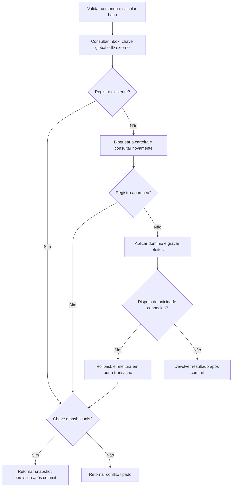
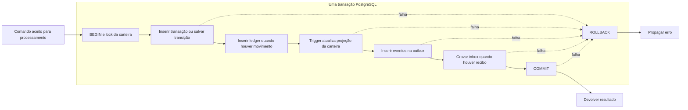
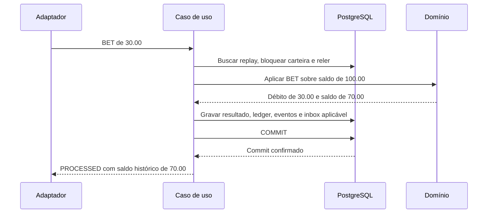
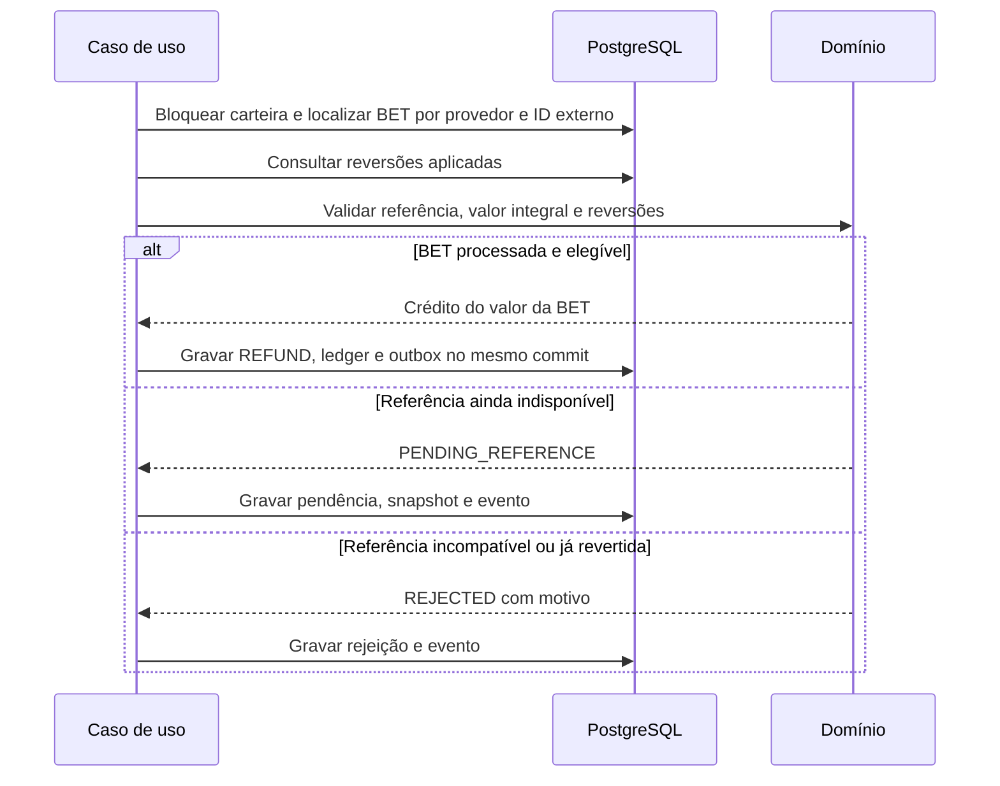
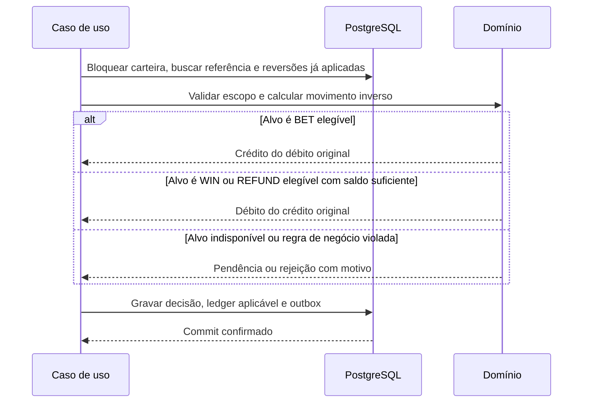
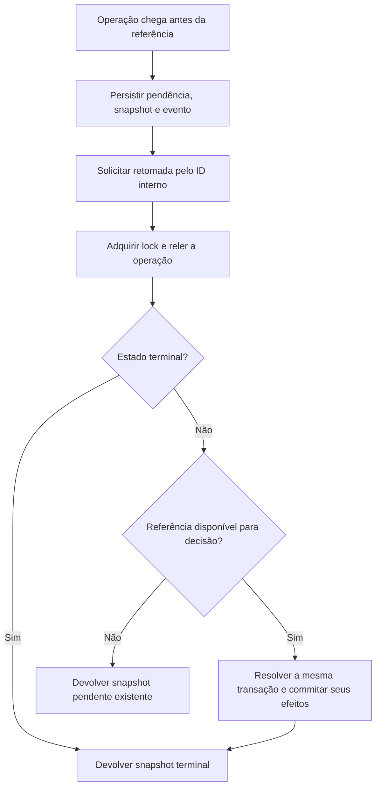
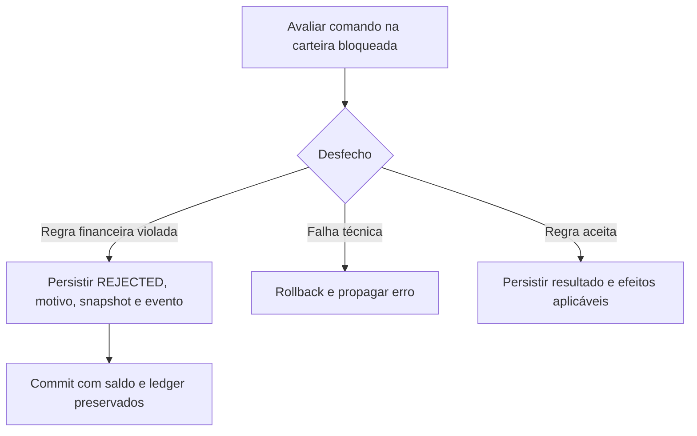

# Motor financeiro

A camada Application recebe comandos de abertura e de apostas e oferece consultas de carteira, ledger e transações. O domínio calcula os efeitos com `Money`, `Wallet` e `WagerTransaction`. O adaptador PostgreSQL reúne os repositórios num `TransactionManager`. O módulo NestJS injeta o adaptador, um relógio e um gerador de IDs nos casos de uso.

## Contratos dos casos de uso

| Caso de uso                                    | Entrada                                                                                                                                       | Saída                                                                                                                                   |
| ---------------------------------------------- | --------------------------------------------------------------------------------------------------------------------------------------------- | --------------------------------------------------------------------------------------------------------------------------------------- |
| `CreateWalletUseCase`                          | Jogador, saldo inicial e rastreamento opcional                                                                                                | ID, jogador, moeda, saldo e versão                                                                                                      |
| `ProcessWagerTransactionUseCase.execute`       | Provedor, ID externo, chave idempotente, carteira, jogador, rodada, jogo, tipo, quantia, referência conforme a operação e metadados opcionais | ID interno, estado, saldo e versão históricos, indicador de replay e, quando houver, motivo, referência interna e data de processamento |
| `ProcessWagerTransactionUseCase.resumePending` | ID interno da transação pendente e rastreamento opcional                                                                                      | Resultado da operação existente                                                                                                         |
| `GetWalletUseCase`                             | ID da carteira                                                                                                                                | Saldo e versão atuais                                                                                                                   |
| `GetWalletLedgerUseCase`                       | ID da carteira, limite e cursor opcionais                                                                                                     | Lançamentos por versão crescente e cursor para a próxima página, quando houver                                                          |
| `GetWagerTransactionUseCase`                   | ID interno da transação                                                                                                                       | Identidades, estado, tipo, quantia, datas e snapshot disponível                                                                         |
| `GetProviderWagerTransactionUseCase`           | Provedor e ID externo                                                                                                                         | A mesma visão para transações do provedor                                                                                               |

O dinheiro entra e sai como `{ amount, currency }`. O valor é uma string decimal exata de duas casas, com até 36 dígitos inteiros. O domínio opera em centavos com `bigint` e o PostgreSQL armazena com precisão decimal. Os identificadores são strings opacas. `correlationId`, `causationId` e a identificação opcional de entrega `inbox` são metadados de transporte. O ledger retorna 50 registros por padrão e aceita até 100. A ordem é por versão e ID. Como a versão é única na carteira, o cursor contém o identificador da carteira e a última versão da página. O caso de uso valida a carteira e a existência dessa versão.

Chaves, hash, timestamps e snapshots são persistidos para reconstruir a resposta depois de reconectar ao banco. A consulta de transação mostra seu snapshot, enquanto a consulta de carteira mostra a projeção atual. Registros anteriores à fase sem snapshot continuam consultáveis. Uma tentativa de replay desse registro retorna `HISTORICAL_RESULT_UNAVAILABLE`.

## Abertura da carteira

O PostgreSQL garante uma carteira por jogador e moeda. Uma abertura com `0.00` cria a carteira na versão 1. Uma abertura positiva cria a mesma projeção inicial, uma transação interna `OPENING`, um crédito de `0.00` para o valor inicial na versão 1 e dois eventos na outbox. Todos os registros são gravados no mesmo commit. A segunda abertura da mesma combinação retorna `WALLET_ALREADY_EXISTS`. O namespace interno de abertura é reservado e a busca por provedor o exclui.

## Idempotência, locking e atomicidade

O SHA-256 usa JSON canônico dos campos financeiros, com chaves ordenadas recursivamente e quantia normalizada. O hash inclui provedor, ID externo, carteira, jogador, rodada, jogo, tipo, quantia, moeda e referência quando aplicável. A chave idempotente é pesquisada separadamente. Rastreamento e inbox ficam fora do hash.

A chave idempotente é global. O par provedor e ID externo identifica a operação no provedor. Uma chave com hash divergente gera `IDEMPOTENCY_CONFLICT`. O mesmo par externo com outra chave gera `EXTERNAL_TRANSACTION_CONFLICT`. Com o mesmo hash e chave, o replay devolve o snapshot persistido e marca `idempotentReplay`. Uma entrega nova da mesma operação pode acrescentar um recibo na inbox.

A ordem de acesso é leitura inicial de inbox e identificadores, lock exclusivo da carteira, releitura dos identificadores e consulta das referências e reversões. A aplicação então grava a transação, o ledger aplicável, a outbox e o recibo de inbox. Toda escrita numa carteira segue a mesma ordem. O lock da carteira cobre a consulta de reversões e a atualização da projeção. Carteiras distintas podem avançar em paralelo. O PostgreSQL usa `READ COMMITTED` para que a releitura enxergue commits ocorridos durante a espera do lock.

O lock tem timeout local à transação. Uma restrição única da chave, do ID externo ou da inbox pode decidir uma corrida entre carteiras. Nesse caso, o perdedor reverte e faz uma releitura em transação nova. Erros de lock, deadlock, serialização e indisponibilidade são propagados como falhas técnicas para uma política de retry do chamador.

## BET

A BET verifica saldo sob lock. Uma aposta de `30.00` em carteira com `100.00` grava um débito, saldo histórico de `70.00` e a nova versão. Se faltar saldo, grava `REJECTED` e o motivo `INSUFFICIENT_FUNDS`.

## WIN e LOSS

O WIN credita a quantia e cria um lançamento. Se o comando traz referência, valida o escopo e o tipo da BET de origem. Após o débito de `30.00` sobre `100.00`, um WIN de `50.00` leva o saldo a `120.00`. O LOSS persiste o resultado com saldo e versão da carteira preservados, e emite apenas o evento de transação processada. O comando LOSS aceita `0.00` e conserva a quantia informada no histórico.

## REFUND

A REFUND restitui integralmente o valor de uma BET processada. A resolução parte de provedor e ID externo. O domínio confirma a carteira, jogador, rodada, moeda, tipo, valor e estado da referência. A REFUND grava seu próprio crédito e aponta para o ID interno da BET.

## ROLLBACK

O ROLLBACK inverte uma BET, WIN ou REFUND processada. Uma BET se torna crédito. Um WIN ou uma REFUND se torna débito, sujeito ao saldo disponível. O ROLLBACK da REFUND liga para a própria REFUND. A regra de negócio e o índice parcial impedem duas reversões aplicadas à mesma referência interna, inclusive a disputa entre REFUND e ROLLBACK da mesma BET.

## Referências pendentes e replay histórico

Uma referência obrigatória ausente ou ainda pendente gera `PENDING_REFERENCE`, com snapshot e um evento. A repetição do comando retorna essa pendência. `resumePending` bloqueia a carteira, relê a operação e resolve a referência novamente. Se ela seguir pendente, o caso de uso retorna o snapshot inicial. Quando há decisão terminal, a mesma transação recebe o novo estado, o snapshot da decisão e os efeitos aplicáveis. A partir daí, o replay retorna o resultado terminal. Retomadas simultâneas compartilham o ID e um único movimento possível.

## Rejeições e falhas

| Categoria                         | Exemplos                                                                              | Efeito                                                                                                              |
| --------------------------------- | ------------------------------------------------------------------------------------- | ------------------------------------------------------------------------------------------------------------------- |
| Regra financeira                  | Fundos insuficientes, moeda divergente, referência inválida, reversão anterior        | `REJECTED`, com motivo, snapshot e evento no commit. O saldo e o ledger são preservados.                            |
| Validação ou conflito do comando  | Entrada inválida, carteira ausente, jogador divergente, chave ou recibo reaproveitado | `ApplicationError` tipado antes da gravação ou rollback quando detectado dentro da transação.                       |
| Falha transitória da persistência | Timeout de lock, deadlock, serialização, conexão indisponível                         | `PersistenceConflictError` ou `PersistenceUnavailableError`. O comando pode ser reapresentado com a chave original. |
| Falha inesperada                  | Violação de integridade fora das colisões mapeadas ou erro interno                    | Propagação do erro e rollback dos efeitos parciais.                                                                 |

A moeda divergente de um comando rejeitado fica em `requested_currency`. A chave estrangeira e o snapshot continuam na moeda da carteira. Um jogador alheio gera falha de aplicação antes de criar uma transação vinculada à carteira.

`FAILED` permanece um estado terminal suportado pelo domínio e pelo schema. A decisão durável de falha técnica após esgotar tentativas pertence à fase que implementa o worker e sua política de recuperação.

## Eventos e invariantes

| Resultado                                                | Eventos gravados                                     |
| -------------------------------------------------------- | ---------------------------------------------------- |
| Abertura positiva ou transação processada com lançamento | `WagerTransactionProcessed` e `WalletBalanceChanged` |
| LOSS processado                                          | `WagerTransactionProcessed`                          |
| Rejeição financeira                                      | `WagerTransactionRejected`                           |
| Primeira entrada em pendência                            | `WagerTransactionPendingReference`                   |

Os eventos usam payload versão 1 e ID estável gerado na gravação. A correlação usa o ID da transação quando ausente no comando. O identificador da mensagem pode ser usado como causa. Replay, reavaliação ainda pendente e abertura zerada preservam a outbox existente.

O saldo materializado é reconciliável com créditos menos débitos. O ledger é append-only, tem um lançamento por operação com efeito e uma entrada por versão da carteira. O saldo permanece não negativo. O PostgreSQL valida cadeia de saldos, precisão, identidade, reversões e a existência do lançamento para o movimento no commit. Os testes sob falha verificam conjuntamente carteira, transações, ledger, inbox e outbox. Consulte os comandos e o ambiente reproduzível no [README](../README.md).

## Integrações das próximas fases

A Fase 5 conecta os casos de uso à API REST, ao cabeçalho de idempotência, aos filtros de exceção e à documentação OpenAPI. Os testes distribuídos exercitam três processos independentes sobre o mesmo PostgreSQL. A Fase 6 integra o consumidor SQS, o ack após commit, o agendamento e prazo de referências e a publicação da outbox. [Contrato HTTP](API_CONTRACT.md) · [Concorrência distribuída](DISTRIBUTED_CONCURRENCY.md)
