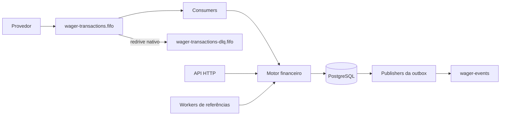
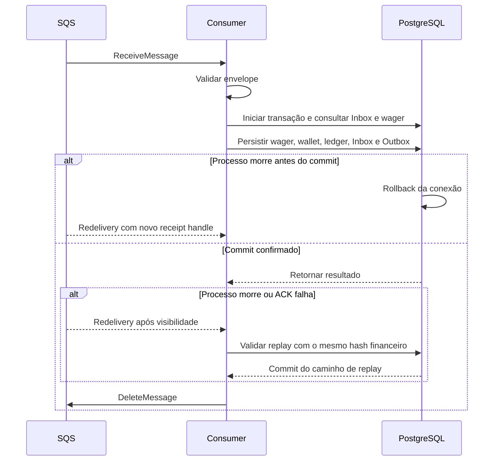
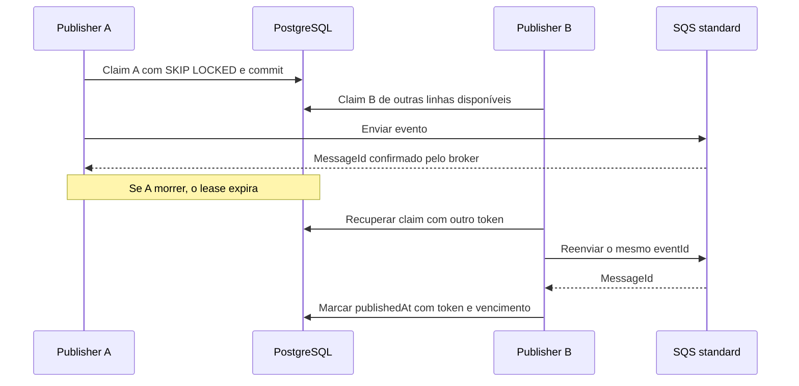
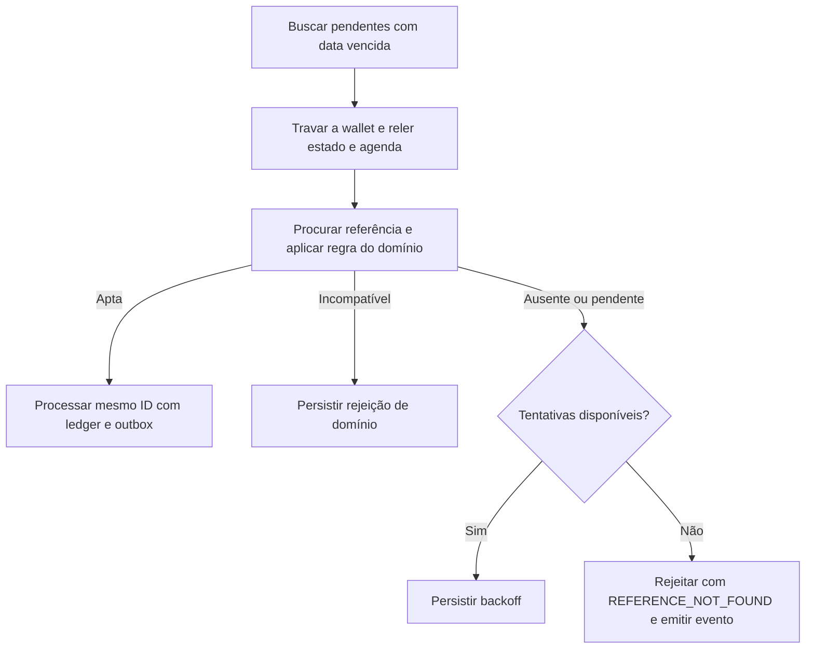

# Mensageria e recuperação distribuída

A API HTTP e os três workers compartilham o domínio, os casos de uso financeiros e o PostgreSQL. O MiniStack fornece SQS local. Cada papel roda em um processo próprio e pode ter várias réplicas.



## Contrato de entrada

```json
{
  "messageId": "msg-123",
  "type": "WagerTransactionRequested",
  "occurredAt": "2026-07-29T15:00:00.000Z",
  "correlationId": "trace-123",
  "data": {
    "providerId": "provider-a",
    "externalTransactionId": "transaction-123",
    "idempotencyKey": "provider-a:transaction-123",
    "playerId": "player-123",
    "walletId": "wallet-123",
    "roundId": "round-987",
    "gameId": "fortune-chimp",
    "kind": "BET",
    "money": { "amount": "25.00", "currency": "BRL" }
  }
}
```

O corpo aceita até 32 KiB em UTF-8, usa ISO 8601 com fuso e rejeita campos desconhecidos. `correlationId` é opcional e usa o `messageId` lógico por padrão. `occurredAt` identifica o instante do produtor. O processamento usa o relógio da aplicação. `REFUND` e `ROLLBACK` exigem `referenceExternalTransactionId`. `WIN` aceita referência opcional. O contrato de dinheiro e as validações são compartilhados com a API.

O produtor deve agrupar por `walletId` e pode usar o ID lógico como `MessageDeduplicationId` para retransmissões idênticas. O SDK recebe `MessageId` e `ReceiptHandle` do broker. O primeiro identifica a entrega nos logs e o segundo autoriza a confirmação. O corpo define o `messageId` da Inbox. Os IDs do transporte e do corpo podem divergir. A operação financeira usa uma chave idempotente global e a identidade `(providerId, externalTransactionId)`. A carteira real e seu proprietário são conferidos pelo motor financeiro, inclusive quando o agrupamento enviado ao SQS difere da carteira.

## Consumer, Inbox e DLQ

Cada processo tem quatro slots por padrão. Cada slot mantém um long poll independente e solicita uma mensagem por vez. A fila FIFO usa visibilidade de 30 s, long polling de 10 s, retenção padrão de quatro dias e DLQ FIFO com retenção de 14 dias. O redrive nativo move a mensagem original ao ultrapassar três recebimentos sem exclusão. O setup aplica os valores configurados.



A chave composta da Inbox usa o mesmo `SQS_CONSUMER_NAME` em todas as réplicas. O caso de uso grava o recibo processado, o wager, a projeção, o ledger e a outbox com o mesmo TransactionManager. A restrição de unicidade vence uma disputa entre instâncias e a operação perdedora relê o resultado em uma transação nova. A idempotência de negócio vale também com IDs lógicos distintos e entre HTTP e SQS. Mudar o conteúdo atrelado à mesma identidade resulta em conflito.

| Resultado                                                         | Decisão do consumer                                                                            |
| ----------------------------------------------------------------- | ---------------------------------------------------------------------------------------------- |
| `PROCESSED`, `REJECTED`, `PENDING_REFERENCE` ou replay persistido | Excluir do SQS após retornar do commit                                                         |
| Lock, deadlock, falha de conexão ou erro sem classificação        | Ajustar visibilidade para 1, 2, 4 s e assim por diante, até 30 s, sob o limite de recebimentos |
| Envelope inválido ou conflito permanente                          | Devolver visibilidade imediatamente para acelerar o redrive nativo                             |
| Última tentativa malsucedida                                      | Devolver visibilidade e deixar o broker encaminhar para a DLQ                                  |
| Falha de `DeleteMessage` ou alteração de visibilidade             | Registrar falha e deixar o SQS recuperar pela expiração                                        |

Durante o trabalho, o consumer renova a visibilidade a cada metade do intervalo, por até cinco minutos. A renovação é cancelada antes do ACK ou reagendamento. Em SIGINT ou SIGTERM, o processo aborta polls ociosos e drena o trabalho ativo até `SHUTDOWN_TIMEOUT_MS`. No vencimento, encerra com código 1. A mensagem volta a ficar disponível quando a visibilidade expirar. Os limites e as semânticas de recebimento, visibilidade e redrive seguem as operações do SQS. [Visibilidade do SQS](https://docs.aws.amazon.com/AWSSimpleQueueService/latest/SQSDeveloperGuide/sqs-visibility-timeout.html)

## Publisher da Outbox

O destino é a fila standard `wager-events`, configurável. Cada evento carrega `eventId`, `eventType`, `version`, `aggregateId`, `correlationId`, `occurredAt`, `data` e `causationId` quando a origem fornece esse vínculo. A versão 1 cobre `WagerTransactionProcessed`, `WagerTransactionRejected`, `WagerTransactionPendingReference` e `WalletBalanceChanged`.



O claim é persistido em uma transação SQL curta que usa `FOR UPDATE SKIP LOCKED`. Cada lote recebe token aleatório e lease de 30 s por padrão. O token e o vencimento protegem a finalização de um claim substituído. Os envios começam fora da transação, com timeout de 3 s por evento. O worker só inicia envio enquanto resta pelo menos esse intervalo no lease. Uma falha reagenda o evento em 1, 2, 4 s e assim por diante, até 60 s. Após o limite padrão de dez falhas registradas, o evento fica estacionado com payload, ID e tentativas preservados. O procedimento para recolocá-lo em entrega está no [runbook](FAILURE_SCENARIOS.md).

O SQS pode entregar eventos físicos repetidos e fora de ordem. Uma resposta ambígua ou um crash após o envio pode provocar outro envio antes de `publishedAt`. Consumidores downstream devem deduplicar de forma durável por `eventId` junto com seus efeitos. `WalletBalanceChanged` inclui a versão da carteira para consumidores que mantêm projeções. O sistema usa relógios sincronizados para os leases e a agenda.

## Worker de referências



O worker lê até 25 candidatos por segundo por padrão. Antes de processar cada ID, adquire o lock da carteira e relê a transação e o horário do próximo retry. A serialização no lock da carteira também vale para API e consumer. Um processo concorrente que chega depois do commit encontra a nova agenda ou o estado terminal. A morte de um processo libera o lock SQL e reverte a tentativa em andamento. Linhas anteriores à migração são elegíveis desde `createdAt`.

O próximo retry usa backoff de 1 s até 60 s. O limite é de dez verificações sem referência apta, com a rejeição no último resultado pendente. O worker preserva o mesmo ID, chave de negócio e hash. Erros transitórios de infraestrutura ficam sujeitos à recuperação do loop e conservam o estado financeiro. A transição posterior mantém `transactionId` como correlação padrão.

## Operação

Os logs JSON registram identidade da instância, resultado, IDs de rastreamento aplicáveis, tentativa e latência ou lag. `bun run queues:inspect` consulta atributos, retenção, redrive e profundidades aproximadas. O runbook inclui consultas de backlog, pendências e estacionados. Contadores, alertas e painéis ficam para a Fase 7. [Cenários e runbook](FAILURE_SCENARIOS.md) · [Demonstração](RESILIENCE_DEMO.md)
