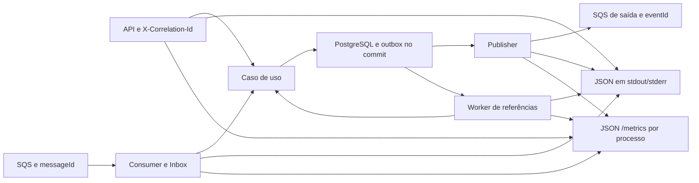
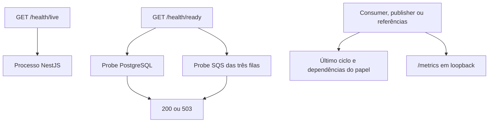
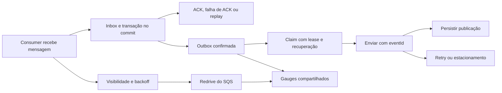

# Observabilidade

O desafio exige logs JSON correlacionados e sanitizados, métricas de status, duplicatas, retries, DLQ, locks, lag da outbox e latência de processamento. Também exige liveness, readiness e sinalização de divergências financeiras. A Fase 7 usa JSON em stdout/stderr e coleta JSON em loopback. Prometheus, Grafana e OpenTelemetry são diferenciais opcionais.

## Logs e correlação

Cada linha inclui `timestamp` ISO 8601, `level`, `service`, `instanceId`, `pid`, `context` e `event`. Configure `INSTANCE_ID` por processo ou use o UUID gerado. Os adaptadores registram `correlationId`, `messageId`, `transactionId`, `walletId` e `providerId` conforme o estágio. Também registram `causationId`, `eventId`, `sourceMessageId`, `transportMessageId`, `attempt`, `errorCode`, `durationMs` e resultado quando disponíveis.

O logger só aceita campos escalares de uma lista explícita. O filtro HTTP mantém códigos estáveis. Logs omitem mensagens livres, stack traces, erros brutos do driver, autorização, credenciais, queries SQL e payloads. A API devolve o `X-Correlation-Id` recebido se válido ou gera um UUID. Um header inválido recebe HTTP 400 e um identificador de resposta gerado pelo servidor. O ID lógico da mensagem SQS é o fallback da correlação.

A outbox persiste `correlationId`, `causationId` e `sourceMessageId` opcional junto com `eventId`. O publisher entrega o envelope e registra o ID de transporte retornado pelo SQS. O worker de referências recupera a correlação do evento persistido. Registros legados sem evento correlacionável usam o ID da transação.

## Coleta e dimensões

Defina `METRICS_PORT` para habilitar `GET /metrics` em `127.0.0.1`. Em processos na mesma máquina, escolha uma porta por processo. Em containers, o coletor consulta no mesmo namespace de rede. O Compose mantém essa porta interna. O formato JSON inclui `instanceId`, `role`, `histogramBoundsSeconds` e famílias de séries. Cada histograma inclui `count`, `sum` em segundos e buckets cumulativos. Colete por processo e agregue taxas de counters. Counters reiniciam com o processo e representam resultados observados pelo adaptador após commit. Um crash pode interromper a observação.

| Métrica                                                                                                     | Tipo                        | Labels e interpretação                                                                                                                                                                                                              |
| ----------------------------------------------------------------------------------------------------------- | --------------------------- | ----------------------------------------------------------------------------------------------------------------------------------------------------------------------------------------------------------------------------------- |
| `wager_transactions_total`                                                                                  | Counter                     | `source,status`. Transições confirmadas de operações externas. Uma referência pode aparecer como pendente e depois como processada ou rejeitada.                                                                                    |
| `wager_idempotency_duplicates_total`, `wager_idempotency_conflicts_total`, `wager_processing_retries_total` | Counter                     | `source`. Replay, conflito de identidade e retry por unicidade, redelivery transitório ou reagendamento de referência.                                                                                                              |
| `wager_wallet_lock_conflicts_total`                                                                         | Counter                     | `reason`. `LOCK_TIMEOUT`, `DEADLOCK`, `SERIALIZATION_FAILURE`.                                                                                                                                                                      |
| `wager_processing_duration_seconds`, `wager_http_duration_seconds`                                          | Histogram                   | `source` e `status_class`, respectivamente. Caso de uso com commit e duração HTTP até encerrar a resposta.                                                                                                                          |
| `wager_wallet_lock_wait_seconds`                                                                            | Histogram                   | Sem labels. Duração da consulta de lock, incluindo espera e round-trip.                                                                                                                                                             |
| `wager_sqs_events_total`                                                                                    | Counter                     | `result`. Recebimento, processamento, duplicata, ACK, falha de ACK, retry, visibilidade, polling e tentativas esgotadas.                                                                                                            |
| `wager_sqs_in_flight`, `wager_sqs_processing_duration_seconds`, `wager_sqs_poll_duration_seconds`           | Gauge, histogram, histogram | Sem labels. Ocupação do consumer, duração até ACK ou reagendamento e duração do ReceiveMessage.                                                                                                                                     |
| `wager_outbox_events_total`, `wager_outbox_publish_duration_seconds`                                        | Counter, histogram          | `result` para claims, recuperação, publicação confirmada, retry, estacionamento, lease e erros. O histograma mede a tentativa de envio ao SQS.                                                                                      |
| `wager_reference_events_total`, `wager_reference_resolution_duration_seconds`                               | Counter, histogram          | `result` para reagendamentos, resolução, expiração e erros. O histograma mede tempo da criação até o estado terminal.                                                                                                               |
| `wager_reconciliation_total`, `wager_reconciliation_duration_seconds`                                       | Counter, histogram          | `result` com `consistent`, `divergent` e `error` para o counter.                                                                                                                                                                    |
| `wager_worker_last_success_timestamp_seconds`, `wager_readiness`                                            | Gauge                       | Último ciclo sem erro do worker e último estado por `dependency`.                                                                                                                                                                   |
| `wager_outbox_messages`, `wager_outbox_lag_seconds`                                                         | Gauge                       | `state` para contagens compartilhadas. Lag em segundos desde o evento mais antigo ainda sem publicação, inclusive estacionados. `high_attempts` conta eventos com ao menos o máximo menos uma tentativa, com piso de uma tentativa. |
| `wager_pending_references`, `wager_pending_reference_oldest_age_seconds`, `wager_inbox_unprocessed`         | Gauge                       | Referências por `state`, idade da mais antiga e recibos sem processamento.                                                                                                                                                          |
| `wager_sqs_queue_messages`, `wager_dlq_messages`                                                            | Gauge                       | `queue,state` para profundidade aproximada, incluindo visíveis, em trânsito e atrasadas. A série DLQ soma os três estados.                                                                                                          |
| `wager_shared_collection_available`, `wager_shared_collection_timestamp_seconds`                            | Gauge                       | `dependency`. Disponibilidade atual e instante da última coleta bem-sucedida.                                                                                                                                                       |

Configure `METRICS_SHARED_INTERVAL_MS=30000` em uma API designada para coletar gauges compartilhados. O mínimo é 10 segundos. Scrapes recebem o último snapshot. Descarte amostras com disponibilidade zero ou timestamp antigo. Retenha uma única série por banco e fila. Para diagnóstico pontual, execute `bun run diagnostics:operations`. No SQS, `awaiting_dlq` indica tentativas esgotadas. Confirme profundidade e crescimento pelos atributos aproximados do broker. [Atributos de filas SQS](https://docs.aws.amazon.com/AWSSimpleQueueService/latest/APIReference/API_GetQueueAttributes.html)

## Saúde e workers

`/health/live` verifica o processo. `/health/ready` exige inicialização completa, PostgreSQL e as três filas SQS. Os probes executam em paralelo, compartilham tentativas e têm orçamento de 2 s. A API retorna 503 durante indisponibilidade ou drenagem. O worker exporta o último ciclo sem erro. Com métricas habilitadas, publica também o estado de PostgreSQL e, para consumer e publisher, da fila usada pelo papel. Interprete o heartbeat junto com backlog e taxa de erros.

## Alertas iniciais

Ajuste as propostas com a linha de base da Fase 8. Use taxas com volume suficiente e alerte também para scrape ou coleta ausente.

| Prioridade | Condição inicial                                                                      | Primeira ação                                          |
| ---------- | ------------------------------------------------------------------------------------- | ------------------------------------------------------ |
| P0         | Uma divergência de reconciliação ou auditoria                                         | Preservar evidências e escalar integridade financeira. |
| P1         | Readiness falha por 60 s ou backlog cresce com worker sem ciclo bem-sucedido por 90 s | Verificar dependências, papel e capacidade.            |
| P1         | DLQ cresce por duas coletas ou tem mensagens há 5 min                                 | Classificar e preservar antes do redrive.              |
| P1         | Outbox lag > 120 s por 5 min ou há evento estacionado                                 | Inspecionar entrega, claims e transporte.              |
| P2         | Referência mais antiga > 300 s ou retries e falhas > 5% das tentativas por 5 min      | Inspecionar referências e taxa de erro por papel.      |
| P2         | p95 do caso de uso > 500 ms ou lock conflicts > 1% das tentativas por 5 min           | Verificar contenção, pool e distribuição de carga.     |

As regras são documentação operacional. [Runbook](OPERATIONS_RUNBOOK.md)
