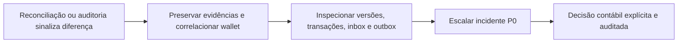
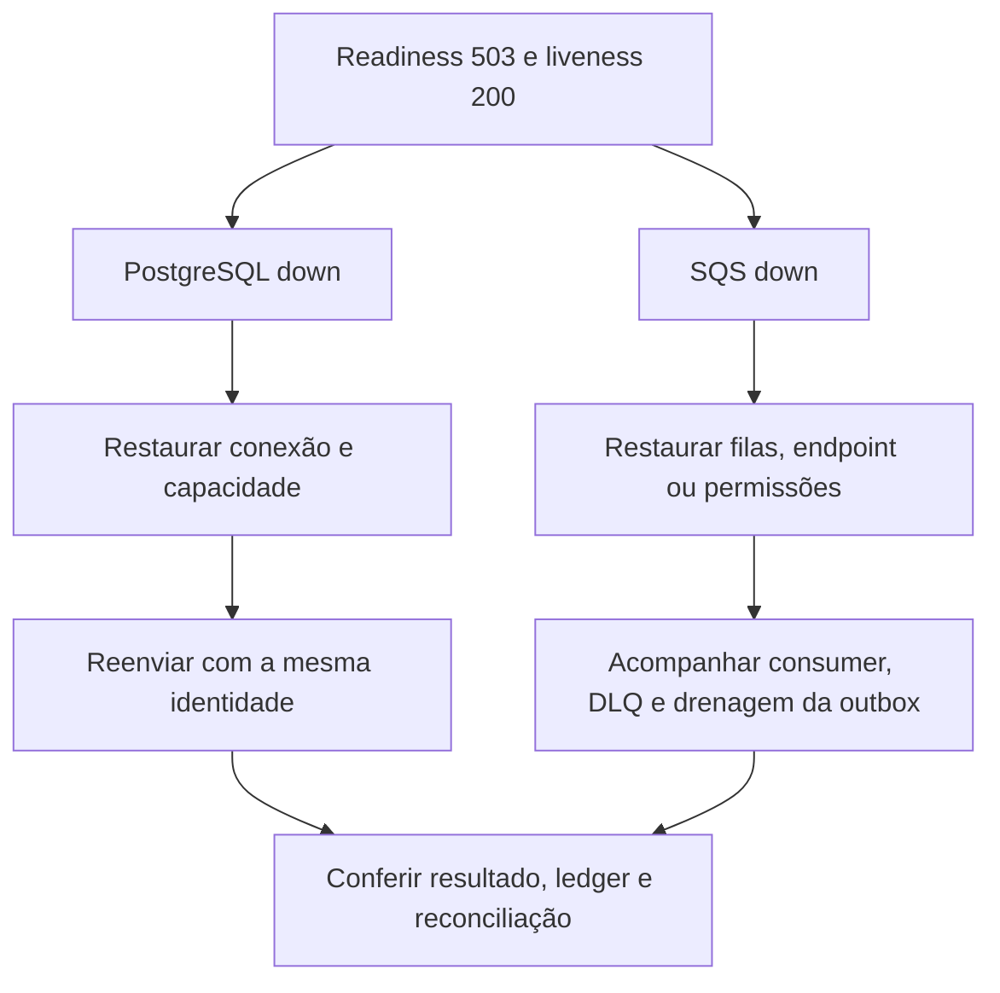

# Runbook operacional

## Primeiros comandos

```powershell
bun run doctor
bun run diagnostics:operations
bun run queues:inspect
docker compose --profile workers ps
docker compose --profile workers logs --since 10m api consumer outbox references
Invoke-RestMethod http://127.0.0.1:3000/health/live
Invoke-RestMethod http://127.0.0.1:3000/health/ready
```

Use a mesma janela UTC, ambiente e `instanceId` ao comparar logs e métricas. Confirme a idade da coleta antes de usar gauges persistentes. Em ambientes com papéis separados, execute `doctor` com a conexão de auditoria e as permissões SQS de leitura.

## Consumer SQS local

Execute `bun run infra:setup` para aplicar migrations, provisionar as filas e conferir os atributos. Em outro terminal, execute `bun run worker:consumer`. Use Ctrl+C no processo local ou `docker compose --profile workers stop consumer` para aguardar a drenagem.

Para publicar manualmente, crie uma carteira pela API e salve o envelope da [arquitetura de mensageria](MESSAGING_ARCHITECTURE.md#contrato-de-entrada) em `wager-request.json`. Preencha `walletId` e `playerId` com os dados da carteira e escolha IDs de mensagem e operação inéditos. Os comandos a seguir usam o MiniStack local padrão.

```powershell
$env:AWS_ACCESS_KEY_ID = "000000000000"
$env:AWS_SECRET_ACCESS_KEY = "local-dev"
$localSqs = "http://127.0.0.1:4567"
$sourceQueue = "$localSqs/000000000000/wager-transactions.fifo"
$deadLetterQueue = "$localSqs/000000000000/wager-transactions-dlq.fifo"
$request = Get-Content -Raw wager-request.json | ConvertFrom-Json
aws --region us-east-1 --endpoint-url $localSqs sqs send-message --queue-url $sourceQueue --message-body file://wager-request.json --message-group-id $request.data.walletId --message-deduplication-id $request.messageId
aws --region us-east-1 --endpoint-url $localSqs sqs receive-message --queue-url $deadLetterQueue --max-number-of-messages 1 --visibility-timeout 5 --message-system-attribute-names All --query 'Messages[].{MessageId:MessageId,Attributes:Attributes}'
```

Use `bun run queues:inspect` para consultar a DLQ sem receber mensagens. Para inspecionar a conclusão, consulte a Inbox e o wager juntos.

```sql
select i.consumer_name, i.message_id, i.received_at, i.processed_at,
       i.transaction_id, w.status, w.failure_code
from wagering.inbox_messages as i
left join wagering.wager_transactions as w on w.id = i.transaction_id
where i.consumer_name = 'wager-processor' and i.message_id = '<messageId>';
```

Execute `bun run demo:inbox` para reproduzir o crash após commit, verificar a reentrega com outro processo e observar o redrive. Se os containers já estiverem ativos, use `bun run test:inbox-recovery`. A demo confere o recibo, o saldo, a unicidade do débito e a reconciliação. Para validar uma carteira após um reinício normal, use `bun run audit:wallets --wallet <walletId>` e consulte o wager pelo ID da Inbox.

## P0 — Divergência financeira

1. Capture o correlation ID, wallet ID, timestamps e saída da reconciliação em armazenamento restrito.
2. Execute `bun run audit:wallets --wallet <walletId>`. Preserve o resumo e o exit code.
3. Consulte `GET /wallets/<walletId>/ledger` pela ordem de versão, seguindo o cursor. Use o transaction ID de cada entrada em `GET /wagering/transactions/<transactionId>`. Cruze moeda, direção, versão, referência, recibos e eventos.
4. Identifique a última versão consistente e escale à equipe responsável por integridade financeira. Registre qualquer decisão sobre isolamento da carteira afetada.
5. Preserve projeção, ledger e dados de origem para investigação. Qualquer decisão contábil depende de revisão explícita e trilha de auditoria.



## P1 — Outbox atrasada

1. Compare lag, quantidade elegível, claims ativos, expirados e estacionados com o último ciclo do publisher.
2. Consulte os eventos mais antigos com a query abaixo, usando acesso de leitura. Correlacione `eventId` com logs de envio e erros SQS.
3. Restaure acesso ao SQS ou reinicie somente o publisher com `docker compose --profile workers restart outbox`. Aguarde a expiração de leases de instâncias que saíram.
4. Confirme publicação e redução do lag. Para estacionamento, use a reativação seletiva revisada em [Cenários de falha](FAILURE_SCENARIOS.md). Preserve o mesmo evento e a deduplicação downstream.

```sql
select id, event_type, occurred_at, attempts, next_attempt_at, claim_until, parked_at
from wagering.outbox_messages
where published_at is null
order by occurred_at, id
limit 25;
```

## P1 — Mensagens na DLQ

1. Confirme crescimento com `diagnostics:operations` e correlacione logs `awaiting_dlq` por ID e tentativa. Os atributos do SQS são aproximados.
2. Registre ID lógico, identidade financeira, erro e evidência sanitizada em área restrita. Inspecionar com ReceiveMessage altera visibilidade temporariamente. Use credencial operacional, lote pequeno e visibilidade controlada.
3. Corrija a causa e revise o conjunto antes de autorizar redrive. Preserve os identificadores da mensagem e da operação. Valide Inbox, replay, estado do provedor e quantidade de entradas após um reenvio de prova.
4. Mantenha mensagens conflitantes ou inválidas em investigação conforme a retenção. A remoção de uma mensagem depende do procedimento aprovado e da evidência preservada.

## P1 — PostgreSQL indisponível

1. Compare liveness e readiness. Use `bun run doctor` e os códigos `PERSISTENCE_UNAVAILABLE`, `LOCK_TIMEOUT` e `DEADLOCK` para separar conectividade de contenção.
2. Verifique o serviço, resolução DNS, TLS, credenciais, conexões e capacidade do banco. Restaure a dependência.
3. Reenvie operações incompletas com a mesma chave e o mesmo payload. Confirme resultado histórico ou processamento único e reconcilie uma carteira afetada.

## P1 — SQS indisponível

1. Verifique endpoint, credenciais, permissões, redrive e filas do papel. Use `bun run doctor` e `bun run queues:inspect`.
2. Restaure acesso e observe polling, ACK, visibilidade e erro de publicação. As operações HTTP confirmadas seguem na outbox para drenagem.
3. Confirme backlog decrescente, saída correlacionada e saldo consistente. Registre os eventos estacionados e mensagens na DLQ separadamente.



## P2 — Referências antigas

1. Compare idade e contagem com o último ciclo de `references`. Consulte IDs e estado via SQL, em ordem de criação.
2. Confirme identidade, rodada e disponibilidade da referência original com o provedor. Analise `referenceAttempts`, reagendamento e expiração.
3. Se a dependência estiver saudável, reinicie `references` com o perfil workers. A concorrência usa o lock por wallet e releitura de estado. Verifique o evento terminal e a reconciliação.

```sql
select id, wallet_id, provider_id, created_at, reference_attempts, reference_next_attempt_at
from wagering.wager_transactions
where status = 'PENDING_REFERENCE'
order by created_at, id
limit 25;
```

## P2 — Contenção ou sobrecarga

1. Cruze a métrica de lock por motivo, histograma de espera e taxa de 503 com o log de wallet/correlação. Verifique `pg_stat_activity` (idade da transação e `wait_event_type`) e `pg_blocking_pids(pid)` sob uma credencial operacional.
2. Verifique hot wallets, pool e latência. Ajuste concorrência de consumer, batches e capacidade de ingresso progressivamente.
3. Preserve a chave idempotente em todas as tentativas e confira a sequência do ledger. [Limites e falhas](FAILURE_SCENARIOS.md)
