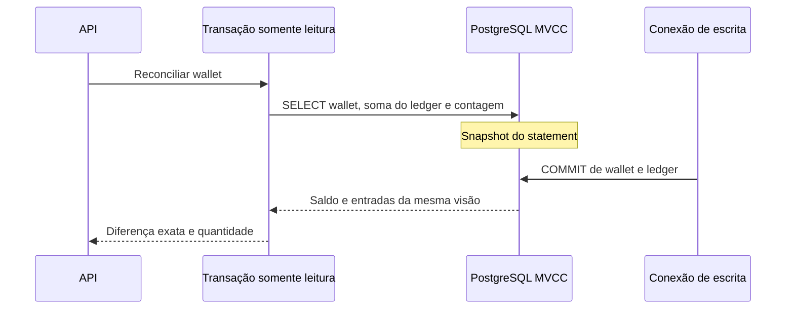

# Reconciliação e auditoria financeira

`POST /wallets/:walletId/reconciliation` executa uma transação PostgreSQL somente leitura. A carteira, a soma das entradas e a contagem saem de um único SELECT. Em `READ COMMITTED`, o snapshot desse statement preserva a visão lógica mesmo enquanto outra conexão confirma uma aposta. Créditos entram com sinal positivo e débitos com sinal negativo. Carteiras de saldo inicial zero podem começar sem entradas. [Isolamento de transações PostgreSQL](https://www.postgresql.org/docs/current/transaction-iso.html)

A diferença segue `storedBalance - calculatedBalance`. PostgreSQL agrega com `NUMERIC` e o adaptador converte a string em `Money`, com precisão por centavos e duas casas decimais. Uma divergência mantém HTTP 200 com `consistent: false`, registra `reconciliation.divergence` e incrementa `wager_reconciliation_total{result=divergent}`. O caminho de leitura preserva o saldo e o ledger.



## CLI de auditoria

```powershell
bun run audit:wallets
bun run audit:wallets --wallet wallet-id
bun run audit:wallets --limit 500 --batch-size 50
```

A auditoria usa uma única transação `REPEATABLE READ READ ONLY` e percorre páginas por ID. Configure `AUDIT_DATABASE_URL` para usar a credencial de auditoria. Sem ela, a operação usa a conexão da aplicação em transação somente leitura. Cada anomalia inclui ID da carteira e códigos estruturais. O resumo representa a soma de entradas por string decimal. As verificações abrangem saldo, moeda, relacionamento entre ledger e aposta, cadeia de versões e saldos, entradas duplicadas, movimentos ausentes e estados `PENDING` ou `FAILED` inesperados no fluxo regular.

| Exit code | Resultado                                                                                     |
| --------- | --------------------------------------------------------------------------------------------- |
| 0         | Auditoria concluída no escopo solicitado, sem anomalias.                                      |
| 1         | Auditoria concluída no escopo solicitado, com anomalias.                                      |
| 2         | Configuração inválida, carteira solicitada ausente, timeout, interrupção ou erro operacional. |

O limite de execução é de 120 s entre consultas e cada consulta tem até 10 s. Em volumes grandes, dimensione o lote e execute em janela controlada, pois um snapshot prolongado retém versões antigas. Uma auditoria limitada cobre a amostra de IDs consultada. [Runbook de divergência](OPERATIONS_RUNBOOK.md)
