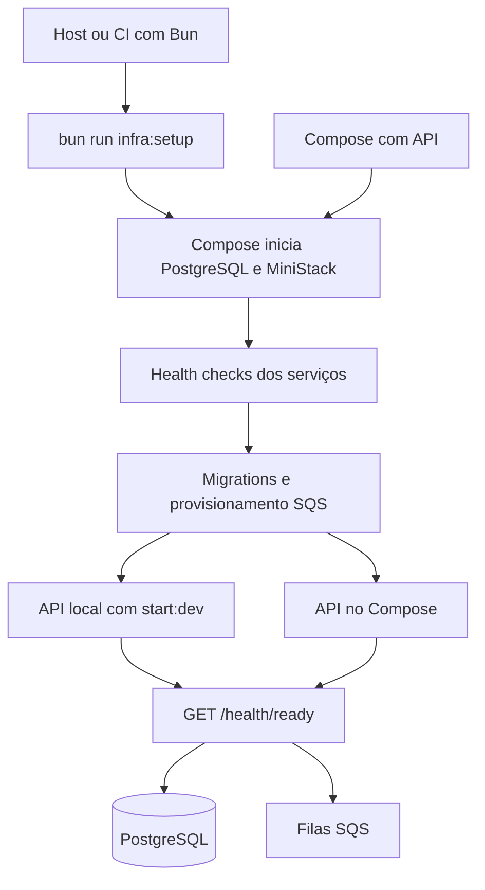

# Inicialização da fundação

No host, o bootstrap aplica migrations e cria filas pelas portas publicadas. No Compose completo, o serviço `setup` usa os nomes internos `postgres` e `sqs`, e a API aguarda sua conclusão.
